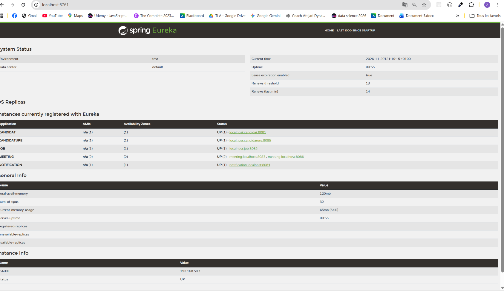
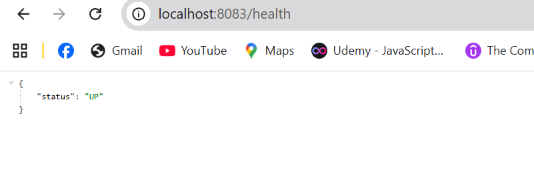
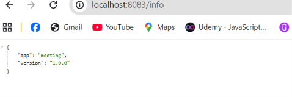
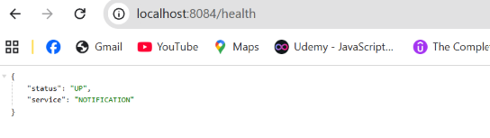
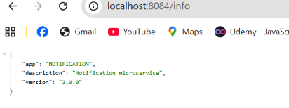

# PROSIT 1 – Architecture Microservices

## Présentation

Projet réalisé dans le cadre de l'atelier Architecture Microservices.

## Membres de l'équipe

- Zeineb Jnene
- Maram Ben Mahmoud
- Aya Ben Aissa
- Mohamed Ali Hmeme

## Architecture

Le projet contient les microservices suivants :

- Candidat
- Candidature
- Job
- Meeting
- Notification
- Eureka Discovery Server

## Dashboard Eureka

Capture d'écran du dashboard Eureka :

## Microservice Meeting

### Health

### Info

## Microservice Notification

### Health

### Info

